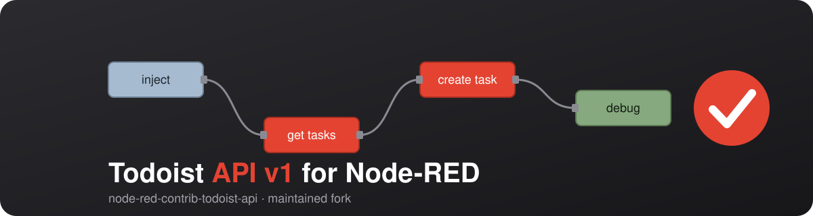

# @constablew/node-red-contrib-todoist-api




> ⚠️ This is a maintained fork of [`@foxleigh81/node-red-contrib-todoist-api`](https://github.com/foxleigh81/node-red-contrib-todoist-api) by Alex Foxleigh, which is no longer maintained.
> Version 2.x targets the **Todoist API v1** (`https://api.todoist.com/api/v1/`). List endpoints (all tasks, all projects) are fetched page by page and returned as a flat array in `msg.payload.data`.

This is a node-red palette that allows you to interact with your [Todoist](https://todoist.com) account via the [Todoist API](https://developer.todoist.com/api/v1/).

## Install

You can install via the node-red palette manager or via npm:

```bash
npm i --unsafe-perm @constablew/node-red-contrib-todoist-api
```

## Usage

### Configuration

To start using these nodes you will need to create a new configuration node, to do this, drag a node from the palette into the flow editor and double click it and add your Todoist API token to the 'select token' dropdown.

To get your todoist personal API token, go to https://todoist.com/app/settings/integrations and click the 'devlopers' tab.

### Adding data

Each node interacts with the Todoist API and returns data in the form of a node-red flow. In order for it to work, you will need to pass the data to the the node via a payload. See the example below for a basic node that creates a new task in your Todoist project.

### Example flow

```json
[
  {
    "id": "cd167cf2edaf6512",
    "type": "inject",
    "z": "a42573365dced8a7",
    "name": "'Create' Task Data",
    "props": [{ "p": "payload" }, { "p": "topic", "vt": "str" }],
    "repeat": "",
    "crontab": "",
    "once": false,
    "onceDelay": 0.1,
    "topic": "",
    "payload": "{\"content\":\"Test Task\",\"project_id\":2184202398,\"priority\":1}",
    "payloadType": "json",
    "x": 410,
    "y": 440,
    "wires": [["57872b84db271bd5"]]
  },
  {
    "id": "57872b84db271bd5",
    "type": "todoist-task-create",
    "z": "a42573365dced8a7",
    "name": "",
    "token": "59a4505979e26f0f",
    "x": 610,
    "y": 440,
    "wires": [["a33919ea4e211f6f"]]
  },
  {
    "id": "a33919ea4e211f6f",
    "type": "debug",
    "z": "a42573365dced8a7",
    "name": "",
    "active": true,
    "tosidebar": true,
    "console": false,
    "tostatus": false,
    "complete": "false",
    "statusVal": "",
    "statusType": "auto",
    "x": 970,
    "y": 680,
    "wires": []
  },
  { "id": "59a4505979e26f0f", "type": "add-todoist-api-token", "name": "Todoist" }
]
```

The payload data in the inject node is the same data as the Todoist API create task item, see the [Todoist API v1 documentation](https://developer.todoist.com/api/v1/).

## Nodes available

This package provides several nodes for common tasks such as:

- Create an individual task
- Get an individual task
- List all tasks (either in a project or on the entire account)
- List all projects
- Update an individual task
- Complete/uncomplete an individual task
- Delete an individual task
- Get tasks by filter (e.g. `today | overdue`), quick add a task from natural language, move a task
- Projects: get, create, update, delete, archive, unarchive
- Sections: list, get, create, update, delete
- Labels: list, get, create, update, delete
- Comments: list, create, update, delete

List nodes load all pages from the API and return them as one array in `msg.payload.data`. Required payload fields (e.g. `id`) are checked before a request is sent.

There is also a generic 'query' node that can be used to query any Todoist endpoint.

Here is a visual representation of the nodes available:


## Test flow

[`examples/todoist-test-flow.json`](examples/todoist-test-flow.json) is an importable flow (Node-RED menu → Import) with one inject per node and a shared debug output for manual testing. It also contains an **auto test** that creates a throw-away project `ClaudeTest`, runs all nodes against it and deletes it again. After importing, enter your Todoist API token in the "Todoist Token" config node and replace the placeholder IDs (`PROJECT_ID`, `TASK_ID`, ...) in the inject payloads for the manual tests.

## License

GNU General Public License v3.0 – see [LICENSE](LICENSE).

Originally created by [Alex Foxleigh](https://github.com/foxleigh81), maintained by [ConstableW](https://github.com/ConstableW).

## Support

Buy Me a Coffee – Maintainer:

[](https://www.buymeacoffee.com/constablew)

Support the original author:

[](https://ko-fi.com/I3I21FRCN)
